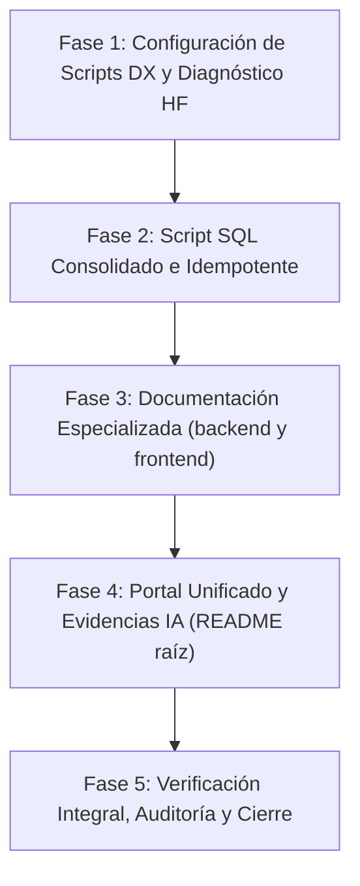

# Plan de Implementación Técnico: 004-documentation-and-evidence

## Información general sobre la arquitectura
Esta funcionalidad consolida todos los entregables de documentación técnica, guías de puesta en marcha, persistencia directa en SQL, herramientas de experiencia de desarrollo (DX) y evidencia experimental de inteligencia artificial para **Semantic Phrase Validator**, culminando la Fase 4 del roadmap.

La arquitectura documental sigue una estrategia modular y jerárquica de 3 niveles desacoplados:
1. **Portal Unificado Monorepo (`README.md` en la raíz):** Punto de entrada global que orquesta la visión general del producto, la arquitectura por capas, la puesta en marcha con Docker y `npm run dev`, el informe de evidencia experimental con Hugging Face, la guía de testing unificado y la solución de problemas transversales.
2. **Portal Técnico del Backend (`backend/README.md`):** Documentación operativa exhaustiva para el servidor Express: catálogo formal de contratos REST (Zod schemas, payloads y códigos HTTP), persistencia con Drizzle ORM, seguridad (Rate Limiting, Content-Type, límite 10 KB), variables de entorno del backend y scripts de IA.
3. **Portal Técnico del Frontend (`frontend/README.md`):** Documentación operativa de la SPA: arquitectura basada en composables de Vue 3, máquina de estados finita de validación semántica (`usePhraseValidation`), diseño utilitario con Tailwind CSS, variables de cliente (`VITE_API_BASE_URL`) y pruebas de componentes con Vue Test Utils.

Asimismo, se provee un script SQL consolidado e idempotente (`scripts/schema.sql`) para despliegue directo en PostgreSQL 17, comandos unificados de ciclo de vida en `package.json` y diagnóstico preventivo en el script de verificación en caliente de Hugging Face.

### Diagrama de Arquitectura Documental y Flujo de Operación

```text
┌────────────────────────────────────────────────────────────────────────────────────────┐
│                                REPOSITORIO MONOREPO                                    │
│                                                                                        │
│   ┌────────────────────────────────────────────────────────────────────────────────┐   │
│   │                        PORTAL GLOBAL (README.md en raíz)                       │   │
│   │  • Visión, Pila y Arquitectura General     • Guía de Inicio Rápido (Docker)    │   │
│   │  • Evidencia Inferencia Hugging Face       • Testing Monorepo (101 tests)      │   │
│   │  • Tabla de 13 Variables de Entorno        • Troubleshooting & CORS (5174)     │   │
│   └───────────────────────────┬────────────────────────────────┬───────────────────┘   │
│                               │                                │                       │
│                               ▼                                ▼                       │
│   ┌──────────────────────────────────────┐  ┌──────────────────────────────────────┐   │
│   │      PORTAL BACKEND (backend/)       │  │      PORTAL FRONTEND (frontend/)     │   │
│   │  • API REST & Schemas Zod            │  │  • Vue 3 (<script setup>) & Tailwind │   │
│   │  • Drizzle ORM & Migraciones         │  │  • Máquina de Estados (7 estados)    │   │
│   │  • Rate Limiting & Hardening 10 KB   │  │  • Sincronización VITE_API_BASE_URL  │   │
│   │  • Script Inferencia Hugging Face    │  │  • Vitest & Component Testing        │   │
│   └──────────────────┬───────────────────┘  └──────────────────┬───────────────────┘   │
│                      │                                         │                       │
│                      ▼                                         ▼                       │
│   ┌──────────────────────────────────────┐  ┌──────────────────────────────────────┐   │
│   │      INFRAESTRUCTURA Y DATOS         │  │          HERRAMIENTAS DX             │   │
│   │  • docker-compose.yml (PostgreSQL 17)│  │  • npm run dev (concurrently)        │   │
│   │  • scripts/schema.sql (Idempotente)  │  │  • npm run test:monorepo (101 tests) │   │
│   │  • docker exec injection support     │  │  • npm run typecheck (TS estricto)   │   │
│   └──────────────────────────────────────┘  └──────────────────────────────────────┘   │
└────────────────────────────────────────────────────────────────────────────────────────┘
```

---

## Pila tecnológica y decisiones clave

### 1. Jerarquía Documental de 3 Niveles vs. README Monolítico
- **Por qué:** Un único `README.md` centralizado que intente abarcar tanto los detalles minuciosos de la API Express (Zod, Drizzle, códigos de error HTTP, Rate Limiting) como la arquitectura reactiva de Vue 3 (composables, Tailwind, Vitest en Happy-DOM) superaría fácilmente las 800 líneas, generando fatiga cognitiva y dificultando la consulta rápida para desarrolladores especializados en backend o frontend. La división en 3 portales mantiene alta cohesión y bajo acoplamiento documental.
- **Alternativas consideradas:**
  - *README monolítico único:* Descartado por falta de modularidad y desorden en proyectos monorepo.
  - *Generadores externos de documentación (Swagger UI / Wiki / Docusaurus):* Descartados para el alcance del proyecto para evitar dependencias de despliegue adicionales y permitir que cualquier desarrollador consulte la documentación directamente desde GitHub o en local mediante Markdown puro.

### 2. Script SQL Consolidado e Idempotente (`scripts/schema.sql`)
- **Por qué:** Permite inicializar el modelo de datos de forma directa en cualquier cliente PostgreSQL estándar (psql, DBeaver, DataGrip, Neon o Supabase) sin exigir la presencia de Node.js, TypeScript o Drizzle CLI.
- **Manejo de Idempotencia:**
  - `CREATE EXTENSION IF NOT EXISTS "pgcrypto";`
  - `CREATE TABLE IF NOT EXISTS "phrases" (...);`
  - Bloque defensivo `DO $$ BEGIN IF NOT EXISTS (...) THEN ALTER TABLE ... ADD CONSTRAINT ... END IF; END $$;` para la clave foránea reflexiva.
  - `CREATE INDEX IF NOT EXISTS "idx_phrases_created_at_id" ON "phrases" (...);`
- **Alternativas consideradas:**
  - *Depender exclusivamente de Drizzle Kit:* Descartado porque obliga a instalar dependencias de Node.js antes de poder interactuar con la base de datos a nivel SQL.

### 3. Evidencia Experimental de Hugging Face
- **Por qué:** El modelo de IA (`sentence-transformers/paraphrase-multilingual-MiniLM-L12-v2`) es el núcleo del valor semántico del sistema. La documentación debe reflejar con transparencia los datos empíricos reales obtenidos durante las pruebas de inferencia:
  - *Coincidencia idéntica:* Score `0.9993` (100% idéntica).
  - *Paráfrasis conceptual:* Score `0.8390` (Duplicado semántico > Umbral `0.80`).
  - *Frase no relacionada:* Score `0.1014` (Sin relación < Umbral `0.80`).
- **Diagnóstico Preventivo en `testHuggingFace.ts`:** Se implementa una intercepción previa que comprueba si `HF_TOKEN` contiene el valor por defecto `hf_dummy_token_for_dev` o si la API retorna errores de autenticación/saldo (401, 402, 403), imprimiendo un mensaje pedagógico que guía al usuario hacia la configuración de su token y saldo en Hugging Face, en lugar de desbordar una excepción de Node sin formato.

### 4. Herramientas Unificadas de Monorepo (Scripts DX)
- **`npm run test:monorepo`:** Enlaza de forma secuencial `npm run test:unit`, `npm run test:integration` y `npm run test:frontend`, deteniendo la ejecución con código de error si cualquiera de las suites falla.
- **`npm run typecheck`:** Ejecuta `tsc --noEmit` en backend y `vue-tsc -b --noEmit` en frontend para garantizar compilación estricta y cero tolerancia a tipos `any`.
- **`npm run test:hf`:** Comando rápido desde la raíz para correr la prueba de inferencia real con Hugging Face.
- **`npm run db:migrate`:** Comando rápido desde la raíz para aplicar migraciones con Drizzle sin navegar a `backend/`.

---

## Secuencia de implementación

La implementación se ejecutará en 5 fases lógicas progresivas:



### Fase 1: Configuración de Scripts DX y Diagnóstico HF
1. Añadir el script `"typecheck": "vue-tsc -b --noEmit"` en `frontend/package.json`.
2. Actualizar `package.json` de la raíz con los scripts unificados: `"db:migrate"`, `"test:hf"`, `"test:monorepo"` y `"typecheck"`.
3. Refactorizar [`backend/src/scripts/testHuggingFace.ts`](file:///c:/Workspaces/nanoxxi93/semantic-phrase-validator/backend/src/scripts/testHuggingFace.ts) para incorporar la validación defensiva de `HF_TOKEN` y orientación clara ante falta de saldo o token dummy.

### Fase 2: Script SQL Consolidado e Idempotente
1. Crear el archivo `scripts/schema.sql` conteniendo el DDL completo, soporte de UUIDs, tabla `phrases`, constraint foránea reflexiva e índice compuesto descendente `(created_at DESC, id DESC)`, todo bajo cláusulas `IF NOT EXISTS`.
2. Validar su ejecución tanto en cliente local como vía `docker exec`.

### Fase 3: Documentación Especializada de Subpaquetes
1. Crear `backend/README.md` detallando la arquitectura de la API, catálogo de endpoints, schemas Zod, variables de entorno del servidor, seguridad y rate limiting.
2. Crear `frontend/README.md` detallando la SPA en Vue 3, máquina de estados de validación, Tailwind CSS, configuración de `VITE_API_BASE_URL` y pruebas de UI.

### Fase 4: Portal Unificado y Evidencias de IA (`README.md` raíz)
1. Reemplazar y expandir integralmente el archivo `README.md` en la raíz con la guía paso a paso de arranque con Docker y `npm run dev`, arquitectura general en ASCII, tabla de 13 variables de entorno, evidencia empírica de Hugging Face y guía de solución de problemas (CORS en 5174, puertos 5432/3000).

### Fase 5: Verificación Integral, Auditoría y Cierre
1. Ejecutar `npm run typecheck` validando ambos paquetes.
2. Ejecutar `npm run test:monorepo` verificando los 101 tests automatizados.
3. Ejecutar `python scripts/check_constitution.py` y `python scripts/validate_sdd.py`.
4. Actualizar `specs/roadmap.md` y `CHANGELOG.md` marcando la Fase 4 como completada.

---

## Comprobación de la Constitución

A continuación se audita sistemáticamente la solución propuesta frente a los principios innegociables de `specs/constitution.md`:

| Regla Constitucional | Estado en este Plan | Justificación Técnica |
|---|:---:|---|
| **1.1 Separación Estricta por Capas en Backend** | ✅ Cumple | La documentación de `backend/README.md` refuerza la separación Controllers ➔ Services ➔ Repositories / Providers sin desvíos. |
| **1.2 Inversión de Dependencias en Inferencia de IA** | ✅ Cumple | Se documenta explícitamente cómo `EmbeddingProvider` desacopla a `PhraseService` del SDK externo y cómo `MockEmbeddingProvider` permite probar los 101 tests sin costo de red. |
| **1.3 Frontend Desacoplado y Basado en Composables** | ✅ Cumple | `frontend/README.md` documenta la máquina de estados dentro de composables, manteniendo los componentes puramente presentacionales y estilizados con Tailwind. |
| **2.1 Validación de Contratos con Zod** | ✅ Cumple | Se documentan exhaustivamente los schemas `validatePhraseSchema`, `createPhraseSchema` y `listPhrasesQuerySchema`. |
| **2.2 Estructura JSON Estandarizada** | ✅ Cumple | Todos los endpoints documentan la estructura canónica `{ success: true, data }` y `{ success: false, error: { code, message, details } }`. |
| **2.3 Códigos HTTP Obligatorios** | ✅ Cumple | Se documenta el mapeo canónico de 200, 201, 400, 409, 413, 415, 429 y 503. |
| **3.1 Variables de Entorno y Seguridad** | ✅ Cumple | Prohibición estricta de incluir tokens reales en los READMEs. Se documentan las 13 variables basadas en plantillas `.env.example`. |
| **4.1 TDD y Cobertura de Pruebas** | ✅ Cumple | Se consolida el comando `test:monorepo` que ejecuta las 3 suites sin omisiones (101 tests). |
| **4.2 Convención Lingüística** | ✅ Cumple | Toda la documentación se redacta en español técnico riguroso; código fuente y scripts en inglés. |
| **4.3 Calidad en Producción y Tipado Estricto** | ✅ Cumple | Integración de `npm run typecheck` en el ciclo de entrega; cero `any` y cero `console.log`. |

---

## Suposiciones y preguntas abiertas

### Suposiciones
1. **Entorno de Ejecución:** Se asume que el desarrollador cuenta con Node.js v20.19.0+ o v24+ y Docker Compose para levantar PostgreSQL 17 en local.
2. **Saldo de Hugging Face:** Se asume que el script en caliente `npm run test:hf` requiere un token con saldo activo en la cuenta de Hugging Face. Quien no disponga de saldo puede verificar la suite completa de 101 tests automáticos mediante el `MockEmbeddingProvider` sin gastar saldo.
3. **Puertos Predeterminados:** Se asume que por defecto están libres los puertos 3000 (Backend), 5173 (Frontend) y 5432 (PostgreSQL), proveyendo pautas claras de reconfiguración en el Troubleshooting en caso de colisión.

### Preguntas Abiertas
- Ninguna pregunta abierta pendiente. La arquitectura y alcance fueron completamente afinados y acordados durante la etapa de `clarify`.
